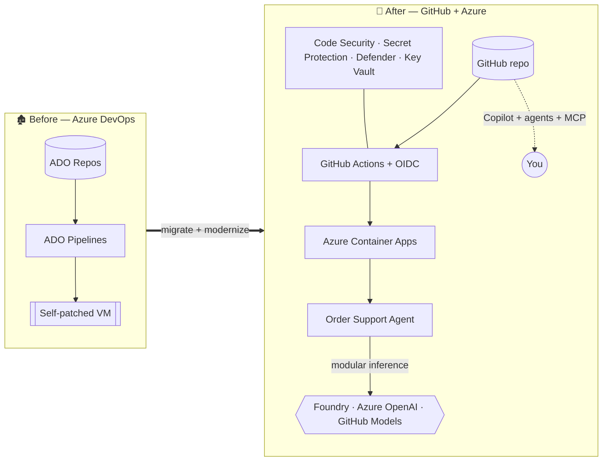

# Contoso Commerce — Agentic DevOps MicroHack

> A **1-day, classroom-led, hands-on** microhack that teaches you how to **deliver** an Agentic DevOps
> platform on **Microsoft Azure + GitHub**. Delivered **Train-the-Trainer**, so you can run it for your
> own customers and teams afterwards.

[](https://github.com/NikoMix/microhack-agentic-devops/actions/workflows/ci.yml)
[](LICENSE)

This microhack is the **technical enablement** companion to the
[Agentic DevOps Advanced Specialization](https://github.com/NikoMix/specialization-agentic-devops).
It exercises the capability behind **Module B → control B.1.1 (Agentic DevOps Implementation Capability)**:
the practical skills a partner needs to design, migrate, secure, and operate AI-assisted SDLC platforms.
The audit/evidence/ACR/certification controls (B.2–B.4) are **handled by the specialization accelerator and
are intentionally out of scope here** — this repo is about *doing the engineering*.

---

## 🎯 The scenario

**Contoso Commerce** runs a legacy **.NET Orders API** inside **Azure DevOps** (Repos, Pipelines, Boards) on a
hand-patched VM. Leadership wants to modernize: move to **GitHub Enterprise Cloud**, run on **Azure Container
Apps**, secure the whole SDLC, adopt **GitHub Copilot + agents**, and launch a brand-new **AI "Order Support /
Triage" service**. Over one day you play the **delivery consultant** who makes it happen.



---

## 🧱 What you build — the six B.1.1 reference architectures

| # | Reference architecture | You will… |
|---|---|---|
| 1 | GHEC + Entra ID + Azure landing zone | Stand up the control plane, dev container, and **GitHub OIDC** to Azure (no secrets) |
| 2 | Self-hosted runners on Azure (VMSS/ARC) | Run Actions on your own Azure compute, federated with OIDC |
| 3 | Copilot coding agent + custom **MCP** servers | Drive delivery with Copilot agents/skills and a custom Azure-facing MCP server |
| 4 | Azure DevOps → GitHub migration | Migrate repos (`gh gei`), Pipelines→Actions, Boards→Issues — Copilot-assisted |
| 5 | Secure SDLC | **Code Security** (CodeQL + Autofix), **Secret Protection**, Dependabot, Defender for Cloud, Key Vault, **signed artifacts** |
| 6 | Agentic release pipeline | PR-triage, release-notes, and on-call agents wired into Actions + MCP |

The new **Order Support Agent** (Python, **Microsoft Agent Framework**) uses **modular inference** — the same
code runs against **Azure AI Foundry**, **Azure OpenAI**, or **GitHub Models** by changing one environment
variable. No image generation; chat/triage only.

---

## 🗓️ Agenda (1 day)

| Time | Module | Ref-arch | Format |
|---|---|---|---|
| 09:00 | Welcome, scenario, platform tour | — | Talk |
| 09:30 | **Challenge 00** — Platform foundation + OIDC | 1 | Lab |
| 10:15 | **Challenge 01** — Azure DevOps → GitHub migration | 4 | Lab |
| 11:15 | **Challenge 02** — Self-hosted runners on Azure + OIDC | 2 | Lab |
| 12:00 | Lunch | — | — |
| 13:00 | **Challenge 03** — Secure SDLC | 5 | Lab |
| 14:00 | **Challenge 04** — Copilot agent + custom MCP server | 3 | Lab |
| 15:00 | **Challenge 05** — Build & deploy the Order Support agent | 3 | Lab |
| 16:15 | **Challenge 06** — Agentic release pipeline *(stretch)* | 6 | Lab |
| 17:00 | Wrap-up, retro, **teardown** | — | Talk |

Full timing, talking points, and facilitation are in [`docs/trainer/`](docs/trainer/). Student instructions are
in [`docs/challenges/`](docs/challenges/).

---

## ✅ Prerequisites

- **GitHub** account with access to GitHub Copilot and (ideally) GitHub Enterprise Cloud features.
- **Azure subscription** with **Owner** (or Contributor + User Access Administrator) on a resource group.
- Ability to deploy in **Sweden Central** (best Foundry model availability) or `West Europe` / `East US 2`.
- A browser — everything runs in **GitHub Codespaces** (the dev container provisions .NET 10, Python 3.12,
  Azure CLI, Bicep, `gh`, Node, cosign automatically). Local VS Code + Docker works too.

Cost is kept low with free/low SKUs and **ephemeral resource groups**; every lab ends with a one-command
teardown ([`scripts/teardown/`](scripts/teardown/)). See [`docs/trainer/prerequisites.md`](docs/trainer/prerequisites.md).

---

## 🚀 Quick start

```bash
# 1) Open in GitHub Codespaces (Code ▸ Codespaces ▸ Create), or clone + "Reopen in Container".
# 2) Authenticate
az login --use-device-code
gh auth login

# 3) Bootstrap GitHub ▸ Azure OIDC (creates an Entra app + federated credentials, no secrets)
./scripts/bootstrap/setup-oidc.sh        # pwsh: ./scripts/bootstrap/setup-oidc.ps1

# 4) Start Challenge 00
code docs/challenges/challenge-00-foundation/README.md
```

---

## 🗂️ Repository layout

```text
.devcontainer/        Polyglot dev container (.NET 10, Python 3.12, az, bicep, gh, node, cosign)
.github/
  agents/             GitHub Copilot custom agents (PR-triage, release-notes, on-call)
  prompts/            Reusable Copilot skills / prompt files
  workflows/          CI + per-workstream pipelines (infra-, orders-api-, security-, agent-, agentic-)
docs/
  trainer/            Train-the-Trainer: facilitator guide, agenda, timing, slides, prerequisites
  challenges/         Student instructions, one folder per challenge (+ coach-notes.md)
infra/                Bicep AVM landing zone, Container Apps, Key Vault, Foundry, runners
migration/            Azure DevOps → GitHub migration assets + scripts
src/
  legacy-orders-api/  .NET 10 Orders API (the migration subject)
  order-support-agent/Python agent (Microsoft Agent Framework + modular inference)
mcp/                  Custom MCP server(s)
scripts/
  bootstrap/          OIDC + landing-zone bootstrap
  teardown/           One-command cleanup of all lab resources
```

---

## 🧑‍🏫 Delivering this as a trainer

Start at [`docs/trainer/README.md`](docs/trainer/README.md). It covers the room setup, the timing model, how
to pre-flight attendee subscriptions, how to recover a stuck lab, and the slide outline. Each challenge ships a
`coach-notes.md` with teaching points, common pitfalls, and "what good looks like".

---

## 📐 Engineering standards

Security-first (OIDC, Key Vault, `DefaultAzureCredential`), latest stable dependencies with **zero known
vulnerabilities**, MIT/Apache-only libraries, and strict linting across .NET, Python, Bicep, and Actions. See
[`.github/copilot-instructions.md`](.github/copilot-instructions.md) for the full contract.

## 📄 License

[MIT](LICENSE). Built for Microsoft + GitHub partner enablement.
