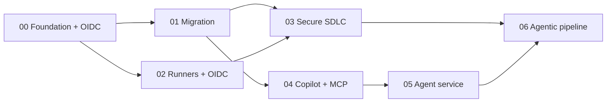

# Challenges

The MicroHack is delivered as **7 hands-on challenges**. Each maps to one of the six **B.1.1 reference
architectures** from the Agentic DevOps Advanced Specialization and builds on the previous one. Work through
them in order — Challenge 00 establishes the OIDC + dev-container foundation everything else depends on.

> Trainers: see [`../trainer/`](../trainer/) for the facilitator guide, agenda, and per-challenge coach notes.

## The path

| # | Challenge | Duration | Reference architecture | You will… |
|---|---|---|---|---|
| 00 | [Platform foundation + OIDC](challenge-00-foundation/) | 45m | 1 — Control plane | Stand up the dev container, wire **GitHub ↔ Entra ID ↔ Azure** with **OIDC** (no secrets), and bootstrap a landing zone |
| 01 | [Azure DevOps → GitHub migration](challenge-01-migration/) | 60m | 4 — Migration topology | Migrate Repos with **GitHub Enterprise Importer**, translate **Pipelines → Actions** (Copilot-assisted), and move **Boards → Issues** |
| 02 | [Self-hosted runners on Azure](challenge-02-runners-oidc/) | 45m | 2 — Runners | Deploy **self-hosted Actions runners** (VMSS / ARC on AKS) that authenticate to Azure via **OIDC** |
| 03 | [Secure SDLC](challenge-03-secure-sdlc/) | 60m | 5 — Secure SDLC | Turn on **Code Security** (CodeQL + Autofix), **Secret Protection**, **Dependabot**, **Defender for Cloud**, **Key Vault**, and **sign artifacts** |
| 04 | [Copilot agent + custom MCP server](challenge-04-copilot-mcp/) | 60m | 3 — Agentic dev | Use the **Copilot coding agent** + custom agents/skills and build a custom **Azure-facing MCP server** with a sane egress + secret model |
| 05 | [Build & deploy the Order Support agent](challenge-05-agent-service/) | 75m | 3 — Agentic dev | Build a **Python** agent (Microsoft Agent Framework) with **modular inference** + OpenTelemetry, and deploy it to **Container Apps** |
| 06 | [Agentic release pipeline](challenge-06-agentic-pipeline/) *(stretch)* | 45m | 6 — Agentic delivery | Add **PR-triage / release-notes / on-call** agents to the pipeline via Actions + MCP |

## How each challenge is structured

Every `challenge-XX-*/` folder contains:

- **`README.md`** — the student lab. Header carries: *Duration · Reference architecture · Learning objectives ·
  Prerequisites · Tasks (numbered) · Success criteria · Stretch goals · Cleanup*.
- **`coach-notes.md`** — the trainer companion: timing, key teaching points, common pitfalls + fixes,
  discussion questions, and "what good looks like".
- *(optional)* **`solution/`** — a reference implementation attendees can fall back to at a checkpoint.

## Dependencies at a glance

## Conventions

- **Inference is modular.** Switch between **GitHub Models**, **Azure OpenAI**, and **Azure AI Foundry** with the
  single `INFERENCE_PROVIDER` env var. Start on GitHub Models (zero Azure cost) and switch to Azure for the
  deploy in Challenge 05. No image generation is used anywhere.
- **No secrets.** Everything authenticates with **Entra ID / `DefaultAzureCredential` / GitHub OIDC** and pulls
  secrets from **Key Vault** at runtime.
- **Cost discipline.** Free/low SKUs, ephemeral per-attendee resource groups, and a scripted **teardown** at the
  end of the day. See [`../trainer/teardown.md`](../trainer/teardown.md).
- **Cleanup is part of every challenge** — each lab ends with a Cleanup section; the full sweep happens at wrap-up.
