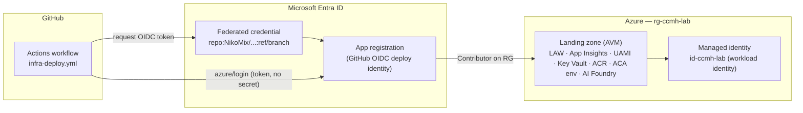

# Challenge 00 — Platform foundation + OIDC

> **Duration:** 45 minutes
> **Reference architecture:** 1 — Control plane
> **Persona:** Platform / DevOps engineer

Stand up the shared foundation every later challenge builds on: a reproducible dev environment, a
**secretless** trust relationship between **GitHub ↔ Entra ID ↔ Azure** (OpenID Connect), and a
**Bicep AVM landing zone** in Azure.

## Learning objectives

By the end of this challenge you can:

- Explain how **GitHub OIDC federation** lets Actions authenticate to Azure with **no stored cloud
  secrets**, and how it differs from a service-principal client secret.
- Bootstrap an Entra **app registration + federated credentials** and a least-privilege role assignment
  using the provided script.
- Read and reason about a **landing zone composed from Azure Verified Modules** (`br/public:avm/res/...`).
- Run a **`what-if`** preview and deploy the landing zone into a per-attendee resource group.
- Verify that every component is **keyless** (Entra ID + managed identity + Key Vault RBAC).

## Reference architecture



> **Two identities, same name — don't confuse them.** The OIDC bootstrap creates an **Entra app
> registration** used by GitHub Actions to *deploy* (control plane). The landing zone creates a
> **user-assigned managed identity** named `id-ccmh-lab` used by *runtime* workloads — Container Apps, the
> runner VMSS — to call Azure data planes keylessly. They live on different planes and are different
> objects that happen to share the lab name.

## Prerequisites

- An Azure subscription where you can create resource groups and **Owner**/`User Access Administrator`
  rights (the bootstrap creates a role assignment).
- The **Azure CLI** (`az`) ≥ 2.60 with bundled Bicep, and the **GitHub CLI** (`gh`) authenticated.
- Permission to create an Entra **app registration** in the tenant (or a pre-created app + the ability to
  add a federated credential).
- The repo opened in the lab **dev container** (VS Code “Reopen in Container”) so everyone shares the same
  toolchain. The dev container already includes `az`, `bicep`, `gh`, and `bash`.

## Tasks

### 1. Open the dev container

Open the repository in VS Code and **Reopen in Container**. Confirm the toolchain:

```bash
az version && az bicep version && gh --version
```

### 2. Bootstrap GitHub ↔ Azure OIDC (no secrets)

Run the **orchestrator-owned** bootstrap script (do not recreate it) — it creates the Entra app
registration, the federated credentials for this repo/branch, the `rg-ccmh-lab` resource group, and a
least-privilege role assignment:

```bash
# bash / dev container
./scripts/bootstrap/setup-oidc.sh --create-rg
```

```powershell
# Windows PowerShell
./scripts/bootstrap/setup-oidc.ps1 -CreateResourceGroup
```

The script prints three **identifiers** (not secrets): `AZURE_CLIENT_ID`, `AZURE_TENANT_ID`,
`AZURE_SUBSCRIPTION_ID`.

### 3. Publish the OIDC identifiers to the repo

Store the three values so `infra-deploy.yml` can log in over OIDC. They are non-secret IDs, but storing
them as Actions **secrets** keeps them out of logs:

```bash
gh secret set AZURE_CLIENT_ID --body "<client-id>"
gh secret set AZURE_TENANT_ID --body "<tenant-id>"
gh secret set AZURE_SUBSCRIPTION_ID --body "<subscription-id>"
```

### 4. Review the landing zone

Open [`infra/main.bicep`](../../../infra/main.bicep) and trace how it composes AVM modules:
Log Analytics → App Insights → managed identity → Key Vault (RBAC) → ACR → Container Apps environment →
AI Foundry account + project, plus the **RBAC role assignments** that make the managed identity keyless.
Note there is **no `secret`/`password`** anywhere. See [`infra/README.md`](../../../infra/README.md) for the
module/version table.

### 5. Preview with `what-if`

Always preview before deploying:

```bash
az deployment group what-if \
  --resource-group rg-ccmh-lab \
  --template-file infra/main.bicep \
  --parameters infra/main.bicepparam
```

Read the change list — everything should be **+ Create**. Discuss what each resource is for.

### 6. Deploy the landing zone

```bash
az deployment group create \
  --name infra-foundation \
  --resource-group rg-ccmh-lab \
  --template-file infra/main.bicep \
  --parameters infra/main.bicepparam \
  --parameters adminPrincipalId="$(az ad signed-in-user show --query id -o tsv)" adminPrincipalType=User
```

Passing your own object ID grants you Key Vault Administrator + Cognitive Services User so you can inspect
secrets and Foundry from the portal/CLI.

### 7. Verify it is keyless

```bash
# Outputs that later challenges consume:
az deployment group show -g rg-ccmh-lab -n infra-foundation --query properties.outputs -o jsonc

# The managed identity's role assignments (least privilege):
MI_PRINCIPAL="$(az deployment group show -g rg-ccmh-lab -n infra-foundation \
  --query properties.outputs.managedIdentityPrincipalId.value -o tsv)"
az role assignment list --assignee "$MI_PRINCIPAL" --all -o table

# Prove Key Vault has no stored app secret and local auth is disabled on Foundry/App Insights:
az keyvault secret list --vault-name "$(az deployment group show -g rg-ccmh-lab -n infra-foundation \
  --query properties.outputs.keyVaultName.value -o tsv)" -o table
```

## Success criteria

- [ ] `setup-oidc.*` completed and the federated credential exists on the Entra app
      (`az ad app federated-credential list`).
- [ ] `AZURE_CLIENT_ID`, `AZURE_TENANT_ID`, `AZURE_SUBSCRIPTION_ID` are set as repo secrets.
- [ ] `az deployment group what-if` ran and showed only **Create** changes.
- [ ] `az deployment group create` succeeded; outputs include the managed identity, Key Vault, ACR,
      Container Apps environment, and Foundry endpoints.
- [ ] The managed identity has **only** the expected roles (AcrPull, Key Vault Secrets User, Cognitive
      Services User, Cognitive Services OpenAI User, Monitoring Metrics Publisher).
- [ ] No secret/password exists in the template, Key Vault, or workflow.

## Stretch goals

- **Tighten the federation subject.** Add a second federated credential scoped to the `lab`
  *environment* (`repo:OWNER/REPO:environment:lab`) and require it on the deploy job.
- **Branch protection meets OIDC.** Restrict the federated credential to `ref:refs/heads/main` and observe
  the deploy job fail from a feature branch — then discuss trade-offs for a teaching repo.
- **Cost guardrail.** Add an Azure **Policy** assignment (or budget) to `rg-ccmh-lab` that blocks non-lab
  SKUs, and re-run `what-if` to see it evaluated.
- **Diagram it.** Regenerate the reference architecture from the deployed resources with
  `az resource list -g rg-ccmh-lab` and compare to the Mermaid diagram above.

## Cleanup

The landing zone is reused by later challenges, so **keep it** until wrap-up. To remove just this
challenge's footprint at the end of the day:

```bash
az group delete --name rg-ccmh-lab --yes --no-wait
```

Also remove the Entra app registration + federated credentials created by the bootstrap (see
[`docs/trainer/teardown.md`](../../trainer/teardown.md)). Full teardown details live there.
