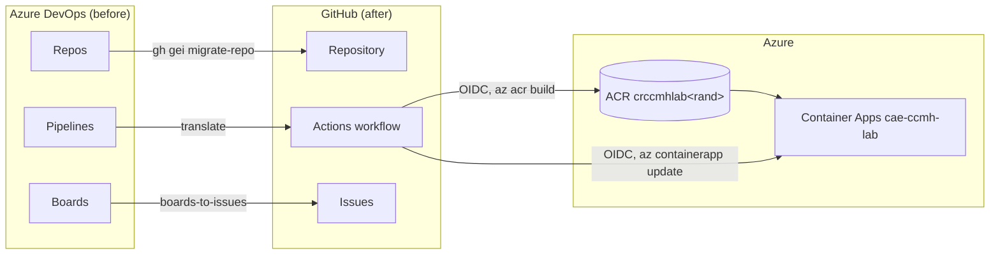

# Challenge 01 — Azure DevOps → GitHub migration

Contoso Commerce runs its legacy **Orders API** on Azure DevOps — Repos, a classic build/release
**Pipeline**, and **Boards**. In this challenge you migrate it to GitHub and Azure: move the repo with
**GitHub Enterprise Importer**, translate the **Pipeline into a GitHub Actions workflow** (Copilot
assists), and recreate **Boards work items as Issues** — replacing every stored credential with
**OIDC** along the way.

## Duration

Plan for **60 minutes**.

## Reference architecture

Reference architecture **4 — Migration topology**.



The container image targets infrastructure provisioned in Challenge 00 / Workstream B (`/infra`). You
**reference** those resources by the shared naming contract; you do **not** create or edit them here.

## Learning objectives

By the end of this challenge you can:

- Run **GitHub Enterprise Importer** (`gh gei` / `gh ado2gh`) to migrate a repo, including a trial run.
- Identify the **PAT scopes** GEI needs and why they are short-lived and disposable.
- Translate an **Azure Pipeline into a GitHub Actions workflow**, and explain how **OIDC**,
  least-privilege `permissions:`, and **SHA-pinned** actions remove stored credentials.
- Recreate **Azure Boards** work items as **GitHub Issues** with a sensible field mapping.
- Complete the entire flow **offline** using the bundled sample export (no source org required).

## Prerequisites

- Challenge 00 complete: dev container, GitHub ↔ Entra ID ↔ Azure **OIDC**, and a landing zone.
- Tools in the dev container: **GitHub CLI** (`gh`), **.NET 10 SDK**, **`jq`**, **PowerShell 7**, plus
  `actionlint` and `markdownlint-cli2` for local validation.
- The two importer extensions:

  ```bash
  gh extension install github/gh-gei
  gh extension install github/gh-ado2gh
  ```

- *(Optional)* Your own Azure DevOps org. **Without one, use the bundled
  [`migration/sample-export/`](../../../migration/sample-export/) and every `--dry-run` path** — you can
  still finish the whole lab.

> **Lab note — CI is billing-blocked.** GitHub Actions will not execute in this account, so you
> **validate locally** (`dotnet build`/`test`, `dotnet list package --vulnerable`, `actionlint`,
> `markdownlint-cli2`). The workflow is authored to go green the moment billing is restored.

## Tasks

1. **Explore the "before."** Read [`src/legacy-orders-api/`](../../../src/legacy-orders-api/): the .NET 10
   Orders API and its classic [`azure-pipelines.yml`](../../../src/legacy-orders-api/azure-pipelines.yml).
   Build and test it locally:

   ```bash
   dotnet build src/legacy-orders-api/Contoso.Orders.slnx -c Release -warnaserror
   dotnet test  src/legacy-orders-api/Contoso.Orders.slnx -c Release
   ```

2. **Prepare the importer.** Read the runbook at
   [`migration/README.md`](../../../migration/README.md). Create the two PATs with the documented scopes
   and a 7-day expiry, and export `ADO_PAT` / `GH_PAT`. (Skip the real tokens if you're using the
   offline path.)

3. **Migrate the repository.** Do a **trial run** into a `*-sandbox` org, then the real migration. With
   no source org, run the offline dry-run:

   ```bash
   ./migration/scripts/migrate-repo.sh \
     --ado-org contoso --ado-team-project Orders --ado-repo orders-api \
     --github-org "$GH_ORG" --github-repo orders-api --dry-run
   ```

4. **Translate the pipeline.** Using [`pipelines-to-actions.md`](../../../migration/pipelines-to-actions.md)
   (and Copilot for the first draft), translate the pipeline into a workflow and compare with the
   reference [`.github/workflows/orders-api-ci.yml`](../../../.github/workflows/orders-api-ci.yml).
   Lint it:

   ```bash
   actionlint .github/workflows/orders-api-ci.yml
   ```

5. **Confirm the credential model is gone.** In the workflow, find: top-level `permissions: contents:
   read`; `id-token: write` only on the deploy job; `azure/login` via **OIDC**; `az acr build` (no
   registry credential); and every action **pinned to a commit SHA**. Note the `vars.*` the deploy job
   expects.

6. **Migrate the boards.** Recreate work items as Issues. Offline first, then live:

   ```bash
   ./migration/scripts/boards-to-issues.sh --dry-run
   ./migration/scripts/boards-to-issues.sh --repo "$GH_ORG/orders-api"
   ```

7. **Validate the whole change locally** (CI can't run):

   ```bash
   dotnet list src/legacy-orders-api/src/Contoso.Orders.Api/Contoso.Orders.Api.csproj \
     package --vulnerable --include-transitive
   actionlint .github/workflows/orders-api-ci.yml
   markdownlint-cli2 "migration/**/*.md" "docs/challenges/challenge-01-migration/**/*.md"
   ```

## Success criteria

- `dotnet build -warnaserror` and `dotnet test` pass; `dotnet list package --vulnerable` reports **no**
  vulnerable packages.
- `actionlint` is clean; the workflow uses **OIDC**, least-privilege `permissions:`, and **SHA-pinned**
  actions, with the `deploy` job gated on `vars.AZURE_CLIENT_ID`.
- `migrate-repo` `--dry-run` prints the correct `gh gei migrate-repo` command and validates prerequisites.
- `boards-to-issues` `--dry-run` lists all 10 sample work items with the right label and open/closed
  mapping; a live run creates the issues and labels.
- You can explain, out loud, **which credentials the migration removed and what replaced them**.

## Stretch goals

- Run `gh ado2gh generate-script --all` and read the generated bulk script (it also `rewire-pipeline`s
  the old pipeline during a transition window).
- Promote ADO **Tags** to GitHub **labels** and **Iteration Path** to **Milestones** in the
  Boards→Issues mapping.
- Rebuild the work-item hierarchy with **sub-issues** or a **GitHub Project**.
- Add a `pull_request` branch-protection rule that requires the `orders-api-ci` check.

## Cleanup

- **Delete the `ADO_PAT` / `GH_PAT`** tokens — they are not needed after migration.
- Delete any `*-sandbox` trial organizations and downloaded migration logs.
- If you created issues/labels in a shared repo during a live run, close or delete them.
- Azure resources are torn down centrally at the end of the day — see
  [`docs/trainer/teardown.md`](../../trainer/teardown.md).
