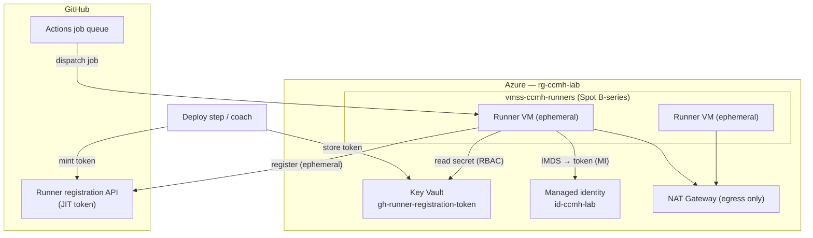

# Challenge 02 — Self-hosted runners on Azure + OIDC

> **Duration:** 45 minutes
> **Reference architecture:** 2 — Runners
> **Persona:** Platform / DevOps engineer
> **Depends on:** [Challenge 00](../challenge-00-foundation/README.md) (landing zone + OIDC)

Deploy a **cost-optimized, secretless** pool of self-hosted GitHub Actions runners on Azure. The runner
hosts bootstrap themselves with **no stored credentials**: at boot each VM uses its **managed identity** to
read a **short-lived registration token** from Key Vault, registers as an **ephemeral** runner, and runs a
clean runner per job. Jobs that touch Azure still authenticate with **GitHub OIDC** (`azure/login`).

## Learning objectives

By the end of this challenge you can:

- Describe **why** and **when** to use self-hosted runners (private networking, custom hardware/tools,
  egress control) versus GitHub-hosted runners.
- Deploy a **VMSS** runner pool from Bicep with **Spot + B-series** capacity for minimum cost.
- Implement a **secretless registration flow**: JIT token → Key Vault → managed identity → `config.sh`.
- Keep runners **ephemeral** (a fresh runner per job) for clean, tamper-resistant builds.
- Explain the **ARC-on-AKS** alternative and the identity model it uses (workload identity federation).

## Reference architecture



## Prerequisites

- Challenge 00 complete: the landing zone is deployed and you have its outputs
  (`managedIdentityResourceId`, `managedIdentityClientId`, `keyVaultName`).
- `gh` authenticated with rights to create a runner registration token for the repo (admin on the repo, or
  org-runner admin).
- Quota for a couple of `Standard_B2s` Spot VMs in the lab region.

## Tasks

### 1. Understand the secretless design

Open [`infra/runners/cloud-init.runner.yaml`](../../../infra/runners/cloud-init.runner.yaml) and
[`infra/modules/runners-vmss.bicep`](../../../infra/modules/runners-vmss.bicep). Note that **the Bicep
contains no token**: the cloud-init script fetches an Entra token from **IMDS** using the managed
identity, reads the registration token from **Key Vault**, verifies the runner tarball **SHA-256**, then
registers with `--ephemeral`. The token is never written to disk.

### 2. Capture the landing-zone outputs

```bash
RG=rg-ccmh-lab
MI_ID="$(az deployment group show -g $RG -n infra-foundation --query properties.outputs.managedIdentityResourceId.value -o tsv)"
MI_CLIENT="$(az deployment group show -g $RG -n infra-foundation --query properties.outputs.managedIdentityClientId.value -o tsv)"
KV="$(az deployment group show -g $RG -n infra-foundation --query properties.outputs.keyVaultName.value -o tsv)"
```

### 3. Mint a JIT registration token into Key Vault

```bash
TOKEN="$(gh api -X POST repos/NikoMix/microhack-agentic-devops/actions/runners/registration-token --jq .token)"
az keyvault secret set --vault-name "$KV" --name gh-runner-registration-token --value "$TOKEN" >/dev/null
```

The token is valid for ~1 hour — plenty to bring the pool online. Because runners are **ephemeral**, plan
to re-mint for large fleets (see Stretch goals for a self-renewing pattern).

### 4. Preview and deploy the runner pool

```bash
az deployment group what-if -g $RG \
  --template-file infra/modules/runners-vmss.bicep \
  --parameters infra/modules/runners-vmss.bicepparam \
  --parameters managedIdentityResourceId="$MI_ID" managedIdentityClientId="$MI_CLIENT" keyVaultName="$KV"

az deployment group create -g $RG --name runners \
  --template-file infra/modules/runners-vmss.bicep \
  --parameters infra/modules/runners-vmss.bicepparam \
  --parameters managedIdentityResourceId="$MI_ID" managedIdentityClientId="$MI_CLIENT" keyVaultName="$KV"
```

### 5. Confirm the runners came online

In GitHub: **Settings → Actions → Runners** — you should see `ccmh-*` runners with the labels
`self-hosted, linux, x64, ccmh, azure`. From Azure, watch the bootstrap log:

```bash
az vmss list-instances -g $RG -n vmss-ccmh-runners -o table
# Boot diagnostics / serial console show /var/log/ccmh-runner-bootstrap.log
```

### 6. Run a job on your pool and prove the OIDC chain

Add a throwaway workflow (or use an existing one) that targets the pool and logs in to Azure over OIDC —
**no secret on the runner**:

```yaml
jobs:
  smoke:
    runs-on: [self-hosted, linux, ccmh]
    permissions:
      id-token: write
      contents: read
    steps:
      - uses: azure/login@532459ea530d8321f2fb9bb10d1e0bcf23869a43 # v3.0.0
        with:
          client-id: ${{ vars.AZURE_CLIENT_ID }}
          tenant-id: ${{ vars.AZURE_TENANT_ID }}
          subscription-id: ${{ vars.AZURE_SUBSCRIPTION_ID }}
      - run: az account show -o table
```

After the job finishes, the ephemeral runner **de-registers itself** and the VMSS model replaces it with a
clean instance.

### 7. Talk cost

The pool is built for the cheapest sensible profile: **Spot** capacity (`useSpot=true`, Deallocate on
eviction), **B-series burstable** SKUs, a small `instanceCount`, and **ephemeral** runners so idle VMs do
no work. Discuss the trade-offs (Spot eviction, B-series CPU credits) and when ARC-on-AKS scale-to-zero is
a better fit.

## Success criteria

- [ ] A `gh-runner-registration-token` secret exists in Key Vault (and is **not** in Git or the Bicep).
- [ ] `what-if` showed a clean Create plan; the deployment succeeded.
- [ ] `ccmh-*` runners appear **Idle/Online** in GitHub with the expected labels.
- [ ] A workflow with `runs-on: [self-hosted, ccmh]` runs and `azure/login` succeeds **using OIDC**, with
      no secret stored on the runner.
- [ ] After the job, the ephemeral runner de-registers; the VMSS holds the configured instance count.
- [ ] The pool has **no inbound** NSG rule (egress only via NAT Gateway) unless break-glass SSH was
      explicitly enabled.

## Stretch goals

- **Self-renewing tokens.** Add a small scheduled workflow (or Azure Function) that re-mints the
  registration token into Key Vault so the pool can scale up without manual steps.
- **Autoscale.** Wire VMSS autoscale rules (or move to ARC) to scale the pool on the Actions queue depth.
- **ARC on AKS.** Stand up [Actions Runner Controller](https://docs.github.com/actions/hosting-your-own-runners/managing-self-hosted-runners-with-actions-runner-controller)
  on an AKS cluster with **workload identity federation** to `id-ccmh-lab` and a Spot node pool; compare
  cold-start, isolation, and cost to the VMSS. See the ARC notes in
  [`infra/README.md`](../../../infra/README.md#alternative-actions-runner-controller-arc-on-aks).
- **Hardening.** Pin the runner image, add an allow-list egress policy on the NAT, and run the
  `installdependencies.sh` step from a cached layer to cut boot time.

## Cleanup

The runner pool is cheap but not free — delete it when you're done with CI-heavy challenges:

```bash
az deployment group create -g rg-ccmh-lab --name runners-down \
  --template-file infra/modules/runners-vmss.bicep \
  --parameters infra/modules/runners-vmss.bicepparam \
  --parameters instanceCount=0 managedIdentityResourceId="$MI_ID" managedIdentityClientId="$MI_CLIENT" keyVaultName="$KV"
# …or remove everything with the resource group at wrap-up:
az group delete --name rg-ccmh-lab --yes --no-wait
```

Also remove the `gh-runner-registration-token` secret and any orphaned runners in **Settings → Actions →
Runners**. Full sweep: [`docs/trainer/teardown.md`](../../trainer/teardown.md).
