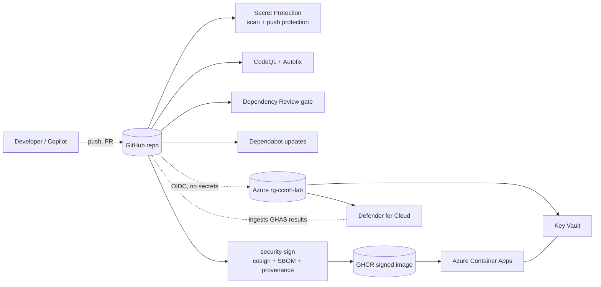

# Challenge 03 — Secure SDLC

> **Duration** 60 min · **Reference architecture** 5 — Secure SDLC · **Builds on** Challenge 00 (OIDC) and
> Challenge 01 (the migrated repo) · **Persona** delivery consultant turning on the guardrails

Contoso Commerce migrated the Orders API to GitHub in Challenge 01. Now you make the SDLC **trustworthy**: turn
on **GitHub Code Security** (CodeQL + Autofix) and **GitHub Secret Protection**, gate dependencies with
**Dependency Review** and **Dependabot**, **sign** the container artifact with keyless cosign (SBOM + SLSA
provenance), and extend posture to Azure with **Defender for Cloud** and **Key Vault** — all with **no secrets
committed** and **OIDC** everywhere.

## Reference architecture



## Learning objectives

By the end of this challenge you can:

- Enable **GitHub Code Security** and **GitHub Secret Protection** and explain the post-2025 GHAS split.
- Run **CodeQL** across **C# and Python** from a shared config, and resolve a finding with **Copilot Autofix**.
- Gate pull requests with **Dependency Review** (vuln + license) and automate fixes with **Dependabot** across
  nuget, uv, npm, github-actions, and docker.
- Demonstrate **push protection** — block a secret, then perform an **audited bypass with a reason** — without
  ever committing a live credential.
- Build, **keyless-sign**, and **verify** a container image with **cosign**, plus generate an **SBOM** and
  **SLSA build provenance**.
- Turn on **Defender for Cloud** posture and store a runtime secret in **Key Vault**, read via
  `DefaultAzureCredential`.

## Prerequisites

- Challenge 00 complete: **GitHub ↔ Entra ID ↔ Azure OIDC** is wired (`AZURE_CLIENT_ID`, `AZURE_TENANT_ID`,
  `AZURE_SUBSCRIPTION_ID` set as repo variables) and `rg-ccmh-lab` exists.
- Challenge 01 complete: the Orders API repository is on GitHub with Actions enabled.
- **GitHub Advanced Security** available on the repo (GHAS — Code Security + Secret Protection). On a public repo
  these are free; on private repos they require a GHAS licence.
- Admin on the repo (to change security settings) and **Owner**/**User Access Administrator** on `rg-ccmh-lab`.
- Dev container / Codespace from Challenge 00 (provides `gh`, `az`, `cosign`, `docker`).

> Deep-dive runbooks for every task live in [`/security`](../../../security/). This README is the guided path;
> the runbooks are the reference.

## Tasks

### 1. Turn on Code Security and Secret Protection (10 min)

Enable the controls for the repository (UI: **Settings → Advanced Security**), or with the CLI:

```bash
gh api -X PATCH repos/<owner>/<repo> \
  -f security_and_analysis='{"secret_scanning":{"status":"enabled"},"secret_scanning_push_protection":{"status":"enabled"}}'
```

Confirm CodeQL, Dependency graph, Dependabot alerts, secret scanning, and push protection all read **enabled**.

### 2. Static analysis with CodeQL + Autofix (12 min)

The [`security-codeql.yml`](../../../.github/workflows/security-codeql.yml) workflow analyses **C#** and
**Python** on a matrix using a shared [`codeql-config.yml`](../../../.github/codeql/codeql-config.yml)
(`security-extended` suite, scoped to `src/` and `mcp/`).

1. Open the workflow and read the matrix — note **`build-mode: none`** (no .NET build required).
2. Trigger it: **Actions → security-codeql → Run workflow**, or push a commit.
3. Open **Security → Code scanning alerts**. Pick a finding and click **Generate fix with Copilot Autofix** —
   review the suggested diff and the explanation, then apply or refine it.

### 3. Dependency Review gate + Dependabot (10 min)

1. [`security-dependency-review.yml`](../../../.github/workflows/security-dependency-review.yml) runs on every
   PR. Open a throwaway PR that adds a deliberately old, vulnerable package and watch the check **fail** with a
   summary comment (severity ≥ low and any non-permissive licence are blocked).
2. Review [`.github/dependabot.yml`](../../../.github/dependabot.yml): five ecosystems
   (**nuget · uv · npm · github-actions · docker**), grouped weekly updates, security updates raised
   automatically. Trigger one now: **Insights → Dependency graph → Dependabot → Check for updates**.

### 4. Secret Protection — block, then bypass with a reason (10 min)

Run the signature teaching moment from [`/security/secret-protection.md`](../../../security/secret-protection.md):

1. Create a **throwaway** fine-grained PAT (you will revoke it).
2. Stage it in a file, commit, and `git push` — **push protection blocks it** before it leaves your machine.
3. Open the URL GitHub prints and **bypass with a reason** — note that the choice is recorded in the **audit
   log** with your identity.
4. **Remove the file and revoke the PAT.** Bypassing does not make a leaked value safe — revocation does.

> The lab never asks you to commit a real, live secret. The throwaway PAT exists only to make the guardrail fire,
> and you destroy it immediately.

### 5. Sign and verify the artifact (12 min)

The reusable [`security-sign.yml`](../../../.github/workflows/security-sign.yml) builds the Orders API image,
**keyless-signs** it (Sigstore + GitHub OIDC), generates an **SPDX SBOM**, and attaches **SLSA provenance**.

1. Run it: **Actions → security-sign → Run workflow** (defaults target `src/legacy-orders-api`). Copy the image
   digest from the run summary.
2. Verify the signature from your terminal (full commands in
   [`/security/artifact-signing.md`](../../../security/artifact-signing.md)):

   ```bash
   cosign verify ghcr.io/<owner>/<repo>/orders-api@<digest> \
     --certificate-identity-regexp "https://github.com/<owner>/<repo>/.github/workflows/security-sign.yml@.*" \
     --certificate-oidc-issuer "https://token.actions.githubusercontent.com" -o text
   ```

3. Verify provenance: `gh attestation verify oci://ghcr.io/<owner>/<repo>/orders-api@<digest> --repo <owner>/<repo>`.

### 6. Extend posture to Azure — Defender + Key Vault (6 min)

1. Enable Defender for Cloud CSPM (free) and the Containers + Key Vault plans, then connect GitHub as a DevOps
   environment so GHAS findings flow into Defender — see
   [`/security/defender-for-cloud.md`](../../../security/defender-for-cloud.md).
2. Create an RBAC-enabled Key Vault, store one runtime secret, and read it with `DefaultAzureCredential` — see
   [`/security/key-vault.md`](../../../security/key-vault.md). Confirm the value never enters git.

## Success criteria

- [ ] Code Security + Secret Protection (scanning **and** push protection) report **enabled**.
- [ ] `security-codeql.yml` runs green for **both** `csharp` and `python`; at least one alert resolved with
      **Copilot Autofix**.
- [ ] A PR introducing a vulnerable/non-permissive dependency is **blocked** by Dependency Review.
- [ ] `.github/dependabot.yml` is active across all **five** ecosystems (a Dependabot PR or "no updates" result
      seen).
- [ ] Push protection **blocked** a throwaway secret; the **bypass-with-reason** is visible in the audit log; the
      value was **removed and revoked**.
- [ ] An image is **signed**, its **SBOM** retrievable, and **`cosign verify` + provenance verify pass** for the
      correct workflow identity.
- [ ] Defender for Cloud CSPM is on with the GitHub connector; a Key Vault secret is read via
      `DefaultAzureCredential` and is **absent from git**.

## Stretch goals

- Switch the CodeQL `csharp` leg to **`build-mode: autobuild`** and compare findings and run time.
- Add **branch protection** requiring `security-codeql` and `security-dependency-review` to pass before merge.
- Tighten `harden-runner` from **audit** to **block** with an egress allowlist on one workflow and read the
  network policy report.
- Enable secret scanning **validity checks** and a **custom pattern** for a Contoso-specific token format.
- Wire `cosign verify` into a deploy gate so an **unsigned** image cannot be promoted (previews Challenge 05).

## Cleanup

- Delete any throwaway demo branch/PR and **revoke** the throwaway PAT from Challenge step 4.
- Reset Defender paid plans to **Free** (`az security pricing create --name Containers --tier Free`, likewise
  `KeyVaults`).
- Resources in `rg-ccmh-lab` are removed by the end-of-day teardown; purge the Key Vault to free the name:

  ```bash
  ./scripts/teardown/teardown.sh --resource-group rg-ccmh-lab --purge --yes
  ```

- Repo-level security settings (CodeQL, Dependabot, Secret Protection) can stay on — they cost nothing on a
  public repo and are good hygiene.

---

Trainer companion: [`coach-notes.md`](coach-notes.md).
