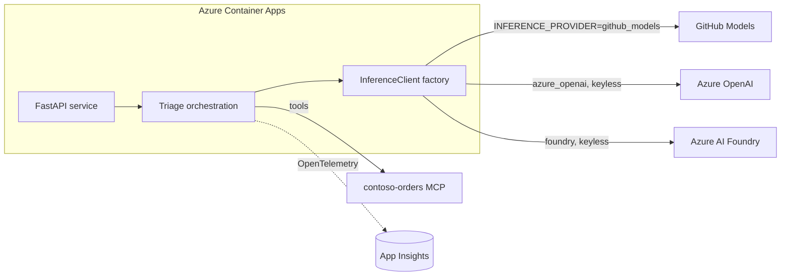

# Challenge 05 · Build & deploy the Order Support agent

You will run, understand, and deploy a **Python Order Support / Triage agent** built on the **Microsoft Agent
Framework** with a **modular inference** layer (GitHub Models · Azure OpenAI · Azure AI Foundry, switchable by
one env var), **OpenTelemetry** wired to App Insights, and the MCP tools from Challenge 04. You finish by
shipping it to **Azure Container Apps** with **keyless** OIDC.

## Duration

75 minutes.

## Reference architecture

Architecture **3 — Agentic dev**. One agent, one tool layer, three interchangeable model providers, full
traces.



## Learning objectives

By the end of this challenge you can:

- Explain the **provider factory**: one `InferenceClient` interface, three providers chosen by
  `INFERENCE_PROVIDER`, swapped with **zero code change**.
- Run a triage end-to-end on **GitHub Models** with only a `GITHUB_TOKEN` (zero Azure cost).
- Switch to **Azure OpenAI** / **Azure AI Foundry** **keyless** (Entra + `DefaultAzureCredential`).
- Serve the agent over HTTP and read its **liveness/readiness/triage** contract.
- Turn on **OpenTelemetry** export to App Insights and find the triage trace.
- Deploy to **Container Apps** with **OIDC + managed identity** — no secrets.

## Prerequisites

- Challenge 00 (OIDC + dev container) and Challenge 04 (the MCP server) complete.
- `uv` and Python 3.12. A `GITHUB_TOKEN` with Models access (`gh auth token` works in the dev container).
- For the Azure providers / deploy: `az login`, and the Workstream-B landing zone provisioned (ACR, ACA env,
  managed identity, App Insights) per the naming contract (`rg-ccmh-lab`, `crccmhlab<rand>`, `cae-ccmh-lab`,
  `appi-ccmh-lab`, `id-ccmh-lab`).
- Code lives under [`src/order-support-agent/`](../../../src/order-support-agent/).

## Tasks

1. **Tour + test.** From `src/order-support-agent/`:

   ```bash
   uv sync
   uv run ruff check . && uv run mypy . && uv run pytest
   ```

   Read [`inference/factory.py`](../../../src/order-support-agent/src/order_support_agent/inference/factory.py)
   and the provider modules beside it. Note the **fake provider** that makes the tests hermetic.
2. **Triage on GitHub Models.** Copy `.env.example` to `.env`, then:

   ```bash
   export GITHUB_TOKEN=$(gh auth token)
   uv run order-support-agent "Order 1001 hasn't moved in six days" --order-id 1001
   ```

   You get a structured recommendation (category, severity, action, customer reply). The agent called the
   order/inventory tools to ground it.
3. **Switch providers — no code change.** Point at Azure OpenAI (keyless):

   ```bash
   export AZURE_OPENAI_ENDPOINT="https://<your-aoai>.openai.azure.com"
   az login
   uv run order-support-agent --provider azure_openai "Refund for order 1002 please" --order-id 1002
   ```

   Only the env (or `--provider`) changed. Try `--provider foundry` with
   `AZURE_AI_FOUNDRY_PROJECT_ENDPOINT` set.
4. **Serve it.** Start the HTTP surface and exercise the contract:

   ```bash
   uv run order-support-agent-serve &
   curl -s localhost:8000/healthz
   curl -s localhost:8000/readyz
   curl -s -X POST localhost:8000/triage \
     -H 'content-type: application/json' \
     -d '{"issue":"Box arrived crushed","order_id":"1002"}'
   ```

   `/readyz` returns 503 until the inference client is built; `/triage` returns the structured
   recommendation.
5. **See the traces.** Add an App Insights connection string and re-run a triage:

   ```bash
   export APPLICATIONINSIGHTS_CONNECTION_STRING="<appi-ccmh-lab connection string>"
   uv run order-support-agent "Where is order 1005?" --order-id 1005
   ```

   Spans/metrics export to App Insights. No string? Use `--console` to print traces locally. Optionally set
   `ENABLE_FOUNDRY_TRACING=true` for the Foundry view.
6. **Wire the live tools (Challenge 04).** Run the MCP server over streamable-HTTP and point the agent at it:

   ```bash
   export ORDERS_MCP_URL="http://localhost:8080/mcp"
   ```

   The agent now resolves tools over MCP instead of the in-process fixtures.
7. **Deploy to Container Apps (keyless).** Ensure the repo/environment **Variables** are set (no secrets):
   `AZURE_CLIENT_ID`, `AZURE_TENANT_ID`, `AZURE_SUBSCRIPTION_ID`, `ACR_NAME`, `AZURE_RESOURCE_GROUP`,
   `AGENT_CONTAINERAPP`, `MCP_CONTAINERAPP`. Then run the **Agent · deploy** workflow
   ([`.github/workflows/agent-deploy.yml`](../../../.github/workflows/agent-deploy.yml)) via *Run workflow*.
   It logs in with OIDC, builds + pushes both images to ACR (keyless), and updates the Container Apps.

## Success criteria

- `uv run pytest` is green (agent suite) and ruff/mypy are clean.
- A triage runs on **GitHub Models** and again on **Azure OpenAI** (or Foundry) with **no code change**.
- `/healthz`, `/readyz`, and `/triage` all respond correctly.
- A triage trace is visible in App Insights (or on the console with `--console`).
- The deploy workflow completes with **no secrets** — only OIDC and Variables.

## Stretch goals

- Add a new field to the recommendation (e.g. `refund_eligible: bool`) end-to-end (model → prompt → test).
- Add a `/triage` integration test that drives the FastAPI app with the fake provider.
- Front the Container App with a **min-replicas=0** scale rule and discuss cold-start vs. cost.
- Emit a custom metric (e.g. `triage.severity`) and chart it in App Insights.

## Cleanup

- Stop background processes (the served agent, the MCP server).
- Scale the Container Apps to zero or delete the per-attendee resource group as part of the day's
  **teardown** — see [`../../trainer/teardown.md`](../../trainer/teardown.md). Switching back to
  `INFERENCE_PROVIDER=github_models` leaves you at **zero Azure cost**.
