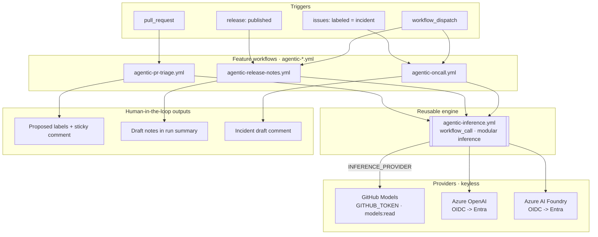

# Challenge 06 — Agentic release pipeline *(stretch)*

> **Duration:** 45 minutes · **Reference architecture:** 6 — Agentic delivery · **Persona:** Platform / DevOps engineer

You have agents that help you *write* code (Challenge 04) and a Python agent running as a *product*
(Challenge 05). This capstone puts agents **inside the delivery pipeline itself**: small, read-only
assistants that triage pull requests, draft release notes, and summarize incidents — invoked by GitHub
Actions, talking to models through the same **modular inference** contract you have used all day, with
**no secrets** and a **human-in-the-loop** on every action that changes anything.

## Learning objectives

By the end of this challenge you will be able to:

- Explain the difference between an **agent that proposes** and a **workflow that acts**, and why that
  split is the foundation of a safe agentic pipeline.
- Author **GitHub Copilot custom agents** (`.github/agents/*.agent.md`) and reusable **prompt/skill files**
  (`.github/prompts/*.prompt.md`) against the documented frontmatter schema.
- Invoke a model from Actions through a **reusable, provider-agnostic inference workflow** (GitHub Models,
  Azure OpenAI, or Azure AI Foundry) using **GitHub OIDC** — zero stored secrets.
- Apply the **least-privilege Actions security model**: empty top-level `permissions`, per-job scopes,
  `pull_request` (not `pull_request_target`), SHA-pinned actions, and untrusted-input handling.
- Reason about the **trust boundary**: what these agents can and cannot do, and where a human must sign off.

## Reference architecture



Three thin **feature workflows** collect context and call one **reusable inference workflow**
(`agentic-inference.yml`). That engine is the Actions analog of the Python `InferenceClient` factory from
Challenge 05: it selects a provider from `INFERENCE_PROVIDER`, authenticates keylessly, and returns the
model's text. The agents themselves (`.github/agents/*.agent.md`) are **read-only proposers**; only the
workflows hold write scopes, and they only ever do reversible things (add allowlisted labels, post a
comment, or — on an explicit, opt-in dispatch — update a release body).

## Prerequisites

- Challenges **03 (Secure SDLC)** and **05 (Agent service)** completed, or their branches available — this
  lab references the security signals and the modular-inference contract they establish.
- Repository **Actions enabled** with a billing plan that allows workflow runs *(if billing is blocked, you
  can still author and lint everything locally — see the coach notes)*.
- Access to **GitHub Models** for the account (the zero-cost default provider). Azure providers are optional.
- Local tooling: [`actionlint`](https://github.com/rhysd/actionlint) and
  [`markdownlint-cli2`](https://github.com/DavidAnson/markdownlint-cli2) (both run in CI; install them to
  validate before you push).

## Tasks

### 1. Read the safety model first

Open [`coach-notes.md`](coach-notes.md) and read the **Safety model** section, then skim the three agent
definitions in [`.github/agents/`](../../../.github/agents/). Confirm for yourself that every agent declares
`tools: ['read', 'search', 'github/*']` — **no write tools**. This is the single most important idea in the
challenge: the *agent* can only read and propose; the *workflow* is the only thing that can change the repo.

### 2. Configure modular inference (repository variables, not secrets)

The engine reads its configuration from repository **variables**. Set at least the provider:

```bash
gh variable set INFERENCE_PROVIDER --body "github_models"
# GitHub Models default model. NOTE: Actions forbids variables that start with GITHUB_,
# so the app's GITHUB_MODELS_MODEL maps to the GH_MODELS_MODEL repository variable here.
gh variable set GH_MODELS_MODEL --body "openai/gpt-4o-mini"
```

To target Azure later, set `INFERENCE_PROVIDER=azure_openai` (or `foundry`) plus the endpoint/deployment
and `AZURE_CLIENT_ID` / `AZURE_TENANT_ID` / `AZURE_SUBSCRIPTION_ID` variables, and grant the calling job
`id-token: write`. **No keys are ever stored** — Azure access is minted on demand through OIDC.

### 3. Trigger PR triage

Open a pull request that changes a few files (for example, edit a doc and a workflow in a branch). Within a
minute, **`agentic-pr-triage.yml`** runs and the **PR-triage agent** posts a sticky comment proposing:

- a small set of labels from the repository taxonomy (`area:*`, `workstream:*`, `challenge:*`), and
- a `risk:low|medium|high` classification with 2–4 evidence bullets.

Inspect the run's **Summary** tab to see the same proposal rendered there. Confirm the labels that appear on
the PR are a subset of the allowlist — the workflow refuses anything outside it.

### 4. Generate release notes on demand

Run the release-notes workflow manually and read the draft (it does **not** publish by default):

```bash
gh workflow run agentic-release-notes.yml -f target_tag=v0.1.0
```

Open the run's **Summary** tab to read the categorized Markdown notes (Features / Fixes / Security / Docs /
Infrastructure / Maintenance) with a highlights paragraph. To actually write them into a release body, re-run
with the explicit opt-in:

```bash
gh workflow run agentic-release-notes.yml -f target_tag=v0.1.0 -f publish=true
```

### 5. Draft an incident summary

Drive the on-call agent two ways:

```bash
gh workflow run agentic-oncall.yml \
  -f title="Orders API 5xx spike" -f severity=Sev2 -f service=orders-api \
  -f signals="HTTP 503 from /orders since 14:02 UTC; ACA replica restarts; DB CPU 95%"
```

Then label any issue **`incident`** and watch **`agentic-oncall.yml`** fire automatically and post a
structured draft (Impact · Probable cause hypotheses · Timeline · Suggested next steps · Comms blurb) as a
comment. Note how the agent separates **facts** from **hypotheses** and never asserts a confirmed root cause.

### 6. Explore the agents and skills in Copilot Chat

The same `.agent.md` files work in Copilot Chat / the CLI. Invoke the reusable skills from
[`.github/prompts/`](../../../.github/prompts/) — for example, run the **PR triage** prompt against an open
PR and compare the agent's interactive proposal with what the workflow produced in Task 3.

### 7. Validate locally (authoring loop)

Before you push any change to an agent, prompt, or workflow, lint it the same way CI will:

```bash
actionlint .github/workflows/agentic-*.yml
markdownlint-cli2 ".github/agents/**/*.md" ".github/prompts/**/*.md" "docs/challenges/challenge-06-agentic-pipeline/**/*.md"
```

## Success criteria

You are done when:

- [ ] All four `agentic-*.yml` workflows pass **`actionlint`** with zero findings.
- [ ] Every agent, prompt, and doc file passes **`markdownlint-cli2`** with zero findings.
- [ ] Opening a PR produces a triage comment with **allowlisted labels** and a **risk** level; labels never
      include anything outside the taxonomy.
- [ ] `agentic-release-notes.yml` (dispatch) produces categorized notes in the run summary and does **not**
      mutate any release unless `publish=true` is passed.
- [ ] Labeling an issue `incident` posts a structured incident draft comment.
- [ ] You can articulate the trust boundary: *agents propose (read-only); workflows act (least-privilege);
      humans approve.*

## Stretch goals

- **Switch providers.** Flip `INFERENCE_PROVIDER` to `azure_openai` or `foundry`, add `id-token: write` to
  the calling job, and confirm the same workflows run keylessly against Azure.
- **Wire in MCP.** Enrich the on-call or triage agent with the custom **MCP server** from Challenge 04 via an
  `mcp-servers` block so it can pull live Azure telemetry (a ready-to-paste snippet is in the coach notes).
- **Feed security signals.** Have the triage agent factor in Challenge 03's CodeQL/Dependabot results to
  sharpen its risk score, and have release-notes cite security provenance.
- **Add a label-driven release.** Extend release-notes to auto-publish only when a maintainer applies a
  `release:approved` label — a second human gate.

## Cleanup

These are repository-config artifacts, not Azure resources, so cleanup is light:

```bash
# Remove the workflow-managed risk labels if you do not want to keep them
gh label delete risk:low --yes 2>/dev/null || true
gh label delete risk:medium --yes 2>/dev/null || true
gh label delete risk:high --yes 2>/dev/null || true

# Optionally disable the workflows while you are not running the lab
gh workflow disable agentic-pr-triage.yml || true
gh workflow disable agentic-release-notes.yml || true
gh workflow disable agentic-oncall.yml || true
```

No Azure resources are created by this challenge unless you completed the Azure-provider stretch goal; if you
did, the day's [teardown script](../../trainer/teardown.md) removes them with the rest of the lab.
