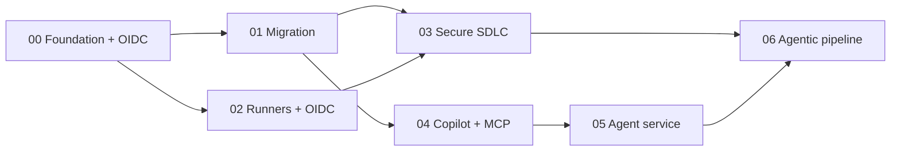

# Agenda

A single day, ~7 hours of content with breaks. Two variants are provided: a **Full Day** (all 7 challenges, 06
as stretch) and a **Short Day** (00–05, skip 06). Times assume a 09:00 start.

## Full day (default)

| Start | End | Block | Ref-arch | Type | Owner |
|---|---|---|---|---|---|
| 09:00 | 09:30 | Welcome, scenario, platform tour | — | Plenary | Lead |
| 09:30 | 10:15 | **Challenge 00 — Platform foundation + OIDC** | 1 | Lab | All |
| 10:15 | 11:15 | **Challenge 01 — Azure DevOps → GitHub migration** | 4 | Lab | All |
| 11:15 | 11:20 | Break | — | — | — |
| 11:20 | 12:00 | **Challenge 02 — Self-hosted runners on Azure + OIDC** | 2 | Lab | All |
| 12:00 | 13:00 | Lunch | — | — | — |
| 13:00 | 14:00 | **Challenge 03 — Secure SDLC** | 5 | Lab | All |
| 14:00 | 15:00 | **Challenge 04 — Copilot agent + custom MCP server** | 3 | Lab | All |
| 15:00 | 15:10 | Break | — | — | — |
| 15:10 | 16:15 | **Challenge 05 — Build & deploy the Order Support agent** | 3 | Lab | All |
| 16:15 | 17:00 | **Challenge 06 — Agentic release pipeline** *(stretch)* | 6 | Lab | All |
| 17:00 | 17:30 | Wrap-up, retro, **teardown** | — | Plenary | Lead |

## Short day (no GitHub Enterprise features required for migration)

Drop Challenge 06 and give the recovered time to 03–05. Use when attendees lack ADO source orgs or Enterprise
features — Challenge 01 can run in "guided demo" mode while attendees follow along on the provided sample export.

| Block | Adjustment |
|---|---|
| Challenge 01 | Run as facilitator-led demo + a 20-min attendee mini-lab on Pipelines→Actions translation |
| Challenge 06 | Cut; mention as "take-home" with the published solution branch |

## Timing model & buffers

- Each lab has a **core path** sized to ~70% of its slot and **stretch goals** for fast movers.
- The 5–10 min breaks are also **catch-up buffers** — coaches clear the backlog there.
- If you are running >15 min behind by lunch, cut Challenge 06 and protect 03–05.

## Dependencies between challenges

- **00 is mandatory first** (it establishes OIDC + the dev container everything else uses).
- 01 and 02 can be swapped if a region/runner issue blocks 02.
- 04 → 05 must stay in order (the MCP server built in 04 is used by 05).
- 06 depends on 03 + 05; it is the natural capstone.

## What "done" looks like per block

Every challenge `README.md` lists explicit **Success criteria**. The room is "on track" when ~70% of attendees
meet them by the checkpoint. Track this on a simple tally; it's your single best pacing signal.
