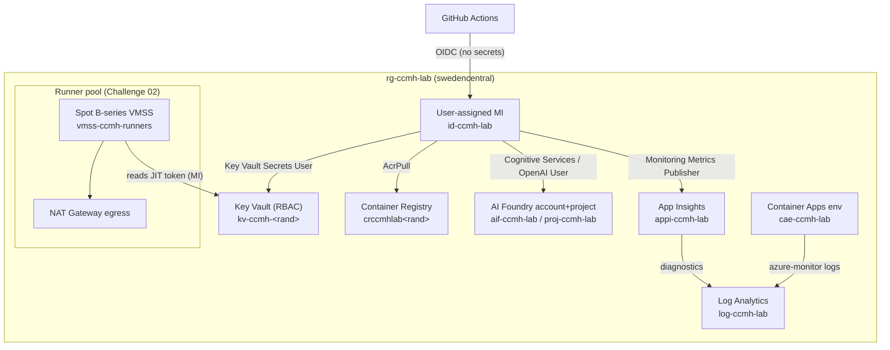

# `infra/` — Contoso Commerce lab landing zone (Bicep AVM)

Infrastructure-as-Code for the **Agentic DevOps MicroHack**. Everything here is composed from
[Azure Verified Modules](https://aka.ms/avm) (`br/public:avm/res/...`), is **secretless** (Entra ID +
managed identity + Key Vault + GitHub OIDC), and is validated with `az bicep lint` + `az deployment group
what-if` before any deploy.

| File | Purpose |
| --- | --- |
| `main.bicep` | Resource-group-scoped landing zone (Challenge 00). |
| `main.bicepparam` | Lab defaults for `main.bicep`. |
| `modules/runners-vmss.bicep` | Cost-optimized self-hosted runner pool (Challenge 02). |
| `modules/runners-vmss.bicepparam` | Lab defaults for the runner pool — wire to landing-zone outputs. |
| `runners/cloud-init.runner.yaml` | Secretless runner bootstrap (JIT token from Key Vault via managed identity). |

## Reference architecture



## What gets deployed

Composed AVM modules (pinned to the latest stable version at authoring time):

| Resource | AVM module | Notes |
| --- | --- | --- |
| Log Analytics workspace | `operational-insights/workspace:0.15.1` | 30-day retention, 1 GB/day cap. |
| Application Insights | `insights/component:0.7.2` | Workspace-based, `disableLocalAuth: true` (keyless). |
| User-assigned managed identity | `managed-identity/user-assigned-identity:0.5.1` | The keyless workload identity. |
| Key Vault | `key-vault/vault:0.13.3` | RBAC authorization, no access policies. |
| Container Registry | `container-registry/registry:0.12.1` | Basic SKU. |
| Container Apps environment | `app/managed-environment:0.13.3` | `azure-monitor` logs → diagnostic setting to LAW. |
| AI Foundry account + project | `cognitive-services/account:0.15.0` | `kind: AIServices`, `disableLocalAuth: true`, text-only chat deployment. |
| Runner pool | `compute/virtual-machine-scale-set:0.11.1` (+ `network/*`) | Spot B-series, ephemeral runners. |

**RBAC (least privilege, granted to the managed identity):** AcrPull, Key Vault Secrets User, Cognitive
Services User, Cognitive Services OpenAI User, Monitoring Metrics Publisher. An optional human
`adminPrincipalId` can be granted Key Vault Administrator + Cognitive Services User for portal/CLI access.

## Prerequisites

1. **Azure CLI** ≥ 2.60 with the bundled Bicep (`az bicep version` ≥ 0.30).
2. **OIDC bootstrap** — run the orchestrator-owned script once to create the Entra app, federated
   credentials, the `rg-ccmh-lab` resource group, and the role assignment:

   ```bash
   # bash
   ./scripts/bootstrap/setup-oidc.sh --create-rg
   ```

   ```powershell
   # PowerShell
   ./scripts/bootstrap/setup-oidc.ps1 -CreateResourceGroup
   ```

   It prints `AZURE_CLIENT_ID`, `AZURE_TENANT_ID`, `AZURE_SUBSCRIPTION_ID`. Store them as
   **repository variables/secrets** (they are identifiers, not credentials) so `infra-deploy.yml` can log
   in over OIDC. See [Challenge 00](../docs/challenges/challenge-00-foundation/README.md).

## Deploy the landing zone

### 1. Preview (what-if) — always run first

```bash
az deployment group what-if \
  --resource-group rg-ccmh-lab \
  --template-file infra/main.bicep \
  --parameters infra/main.bicepparam
```

> **CI note:** GitHub Actions billing is disabled for this account, so the hosted `what-if` job in
> `infra-deploy.yml` will not run until billing is restored. Run the command above locally (or in Cloud
> Shell) to capture the preview. The workflow is authored to pass once billing is fixed.

### 2. Create

```bash
az deployment group create \
  --name infra-$(date +%Y%m%d%H%M%S) \
  --resource-group rg-ccmh-lab \
  --template-file infra/main.bicep \
  --parameters infra/main.bicepparam
```

Grant your own identity data-plane access by passing your object ID:

```bash
az deployment group create -g rg-ccmh-lab -f infra/main.bicep -p infra/main.bicepparam \
  --parameters adminPrincipalId="$(az ad signed-in-user show --query id -o tsv)" adminPrincipalType=User
```

### Outputs (consumed by later challenges)

| Output | Used by |
| --- | --- |
| `managedIdentityResourceId` / `managedIdentityClientId` / `managedIdentityPrincipalId` | Container Apps + runner VMSS attach; `DefaultAzureCredential`. |
| `keyVaultName` / `keyVaultUri` | Runner registration token storage; app config. |
| `containerRegistryLoginServer` | `docker build`/`push`, Container Apps image. |
| `containerAppsEnvironmentResourceId` | Orders API + agent app deployments. |
| `foundryAccountEndpoint` / `chatDeploymentName` | Modular inference (`AZURE_OPENAI_ENDPOINT` / `AZURE_AI_FOUNDRY_*`). |
| `applicationInsightsConnectionString` | Keyless OpenTelemetry export. |

Read them back any time:

```bash
az deployment group show -g rg-ccmh-lab -n <deployment-name> --query properties.outputs -o json
```

## Deploy the self-hosted runner pool (Challenge 02)

The runner pool is **secretless**: the Bicep contains no registration token. The deploy flow mints a
short-lived JIT token, stores it in Key Vault, and the VMs read it at boot via the managed identity.

```bash
# 1. Mint a JIT registration token (repo scope) and store it in Key Vault.
TOKEN="$(gh api -X POST repos/NikoMix/microhack-agentic-devops/actions/runners/registration-token \
  --jq .token)"
az keyvault secret set --vault-name <kv-ccmh-xxxxxx> \
  --name gh-runner-registration-token --value "$TOKEN" >/dev/null

# 2. Deploy the pool, wiring the landing-zone outputs.
az deployment group create -g rg-ccmh-lab \
  --template-file infra/modules/runners-vmss.bicep \
  --parameters infra/modules/runners-vmss.bicepparam \
  --parameters managedIdentityResourceId=<...> managedIdentityClientId=<...> keyVaultName=<kv-ccmh-xxxxxx>
```

Cost levers (all in `runners-vmss.bicepparam`): `useSpot=true` (Spot capacity), `vmSku=Standard_B2s`
(burstable), `instanceCount`, and `runnerEphemeral=true` (a clean VM-side runner per job). The pool has
**no inbound** path — egress is via a NAT Gateway and the NSG denies inbound by default; set
`adminSshPublicKey` + `allowSshFromCidr` only for break-glass debugging.

### Alternative: Actions Runner Controller (ARC) on AKS

For elastic, container-native runners, run [ARC](https://docs.github.com/actions/hosting-your-own-runners/managing-self-hosted-runners-with-actions-runner-controller)
on AKS instead of the VMSS:

- **Identity:** enable **AKS Workload Identity** (OIDC issuer) and federate a Kubernetes service account to
  the `id-ccmh-lab` managed identity — the keyless equivalent of the VMSS managed identity. ARC then reads
  the GitHub App credentials from a Kubernetes secret synced from Key Vault via the **Secrets Store CSI
  driver** (no secret in Git).
- **Scaling:** ARC scales runner pods to zero between jobs; combine with the AKS Cluster Autoscaler on a
  Spot node pool for the same cost profile as the VMSS, with faster cold starts.
- **Auth to GitHub:** prefer a **GitHub App** (org-scoped, fine-grained) over a PAT for ARC registration.
- **When to choose which:** VMSS = simplest, lowest moving parts, great for a 1-day lab. ARC = best when
  the org already runs AKS and wants autoscaling + pod isolation. Both keep the *job-side* `azure/login`
  on GitHub OIDC; the managed/workload identity only bootstraps the runner host.

## Local validation

```bash
# Bicep (restores real AVM interfaces, type-checks, lints):
az bicep build --file infra/main.bicep
az bicep lint  --file infra/main.bicep
az bicep build --file infra/modules/runners-vmss.bicep
az bicep lint  --file infra/modules/runners-vmss.bicep
az bicep build-params --file infra/main.bicepparam --outfile /tmp/main.params.json

# Workflow:
actionlint .github/workflows/infra-deploy.yml

# Docs:
markdownlint-cli2 "infra/**/*.md" "docs/challenges/challenge-0[02]-*/**/*.md"
```

All Bicep here builds and lints with **zero** warnings.

## Cleanup

The whole lab tears down by deleting the resource group (every resource is tagged
`lifecycle: ephemeral`):

```bash
az group delete --name rg-ccmh-lab --yes --no-wait
```

See [`docs/trainer/teardown.md`](../docs/trainer/teardown.md) for the full teardown, including removing the
Entra app registration and federated credentials created by the OIDC bootstrap.
