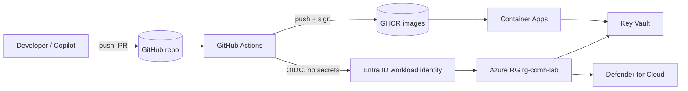

# Threat model — Contoso Commerce Agentic DevOps platform

A deliberately lightweight **STRIDE-lite** model so attendees can reason about *why* each control exists rather
than turning knobs blindly. It covers the lab platform as built across Challenges 00–05: a GitHub repository, a
GitHub Actions supply chain (with OIDC to Azure), and the runtime on Azure Container Apps.

> Scope: the engineering platform and its supply chain. Application-level business logic threats for the Orders
> API and the agent are owned by their respective workstreams; this model focuses on the SDLC and delivery path.

## Assets we are protecting

- **Source + IP** — the Orders API and the Order Support agent code.
- **The build/release pipeline** — GitHub Actions workflows and the runners that execute them.
- **Published artifacts** — container images consumed by Azure Container Apps.
- **Identities + access** — the Entra ID workload identity that GitHub federates into, and its Azure RBAC.
- **Runtime secrets** — API keys / connection material, held only in Key Vault.

## Trust boundaries

Each arrow that crosses from one box to another is a boundary worth a control. The two highest-value boundaries
in this lab are **Developer → Repo** (where Secret Protection and branch protection live) and
**Actions → Azure** (where OIDC replaces standing secrets).

## STRIDE-lite — threat to control

| STRIDE | Threat in this platform | Primary control(s) |
| --- | --- | --- |
| **S**poofing | A workflow or person impersonates the deploy identity | GitHub **OIDC** federation to a single Entra app + subject-scoped federated credentials; no shared secrets |
| **T**ampering | Malicious code or a poisoned dependency enters `main` | **CodeQL** + **Dependency Review** PR gate, branch protection, required reviews |
| **T**ampering | A build artifact is swapped before deploy | **cosign** signature + **SLSA provenance**; runtime verifies signature before run |
| **R**epudiation | "We don't know what shipped or who approved it" | Signed commits + **provenance attestation** ties an image digest to a commit, workflow, and runner |
| **I**nformation disclosure | A credential is committed or leaks in logs | **Secret Protection** (scanning + push protection), `DefaultAzureCredential`, **Key Vault**, gitleaks pre-commit |
| **I**nformation disclosure | A vulnerable dependency exfiltrates data at runtime | **Dependabot** + **Dependency Review** keep deps patched; **Defender for Cloud** flags risky runtime posture |
| **D**enial of service | Dependency confusion / typosquat breaks the build | Pinned, lockfile-driven dependencies; Dependabot grouped updates; SHA-pinned Actions |
| **E**levation of privilege | A workflow grabs more access than it needs | Least-privilege `permissions:` per job; RG-scoped Azure RBAC; runner hardening (`harden-runner`) |

## Supply-chain specifics (the part teams under-invest in)

1. **Pin everything.** Third-party Actions are pinned by **commit SHA**, container base images by digest where
   practical, and language deps by lockfile. A moving tag (`@v4`) is a supply-chain liability.
2. **Two gates, two jobs.** Dependency Review gates the *incoming PR diff*; Dependabot fixes what is *already on
   `main`*. You need both — neither covers the other's window.
3. **Sign at build, verify at deploy.** A signature nobody verifies is theatre. The deploy step (Challenge 05)
   runs `cosign verify` with the workflow identity before it promotes an image.
4. **Keyless > keys.** cosign keyless (Sigstore + OIDC) means there is no signing key to steal or rotate — the
   identity *is* the GitHub workflow.

## Residual risks accepted for the lab

- Self-hosted runners (Challenge 02) widen the trust boundary; in the lab they are ephemeral and RG-scoped.
- `harden-runner` runs in **audit** (non-blocking) mode so labs never hard-fail on egress; production should
  move to **block** with an allowlist.
- `fail-on-severity: low` on Dependency Review is intentionally strict for teaching; real projects tune it with
  documented `allow-ghsas` exceptions rather than loosening the bar globally.

## How to use this in the room

Walk the diagram once, name the two highest-value boundaries, then let each control "answer" a row of the STRIDE
table as you enable it. By the end of Challenge 03 every row above should map to something the attendees turned
on themselves.
