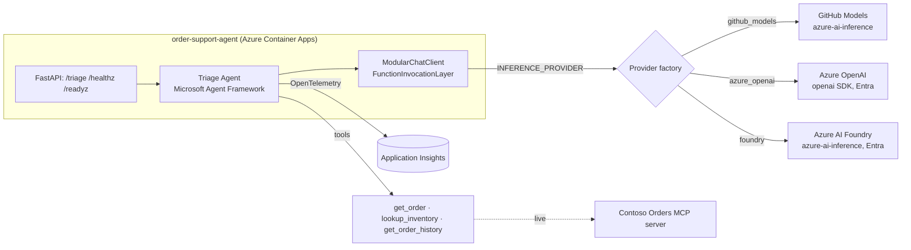

# Order Support / Triage Agent

A Python agent that triages a **Contoso Commerce** order issue and returns a **structured
recommendation**. Built on the **Microsoft Agent Framework** with a **modular inference layer** —
the same code runs against **GitHub Models**, **Azure OpenAI**, or **Azure AI Foundry**, selected by a
single `INFERENCE_PROVIDER` environment variable with **no code change**. Telemetry is emitted via
**OpenTelemetry** to **Application Insights** (with an optional Foundry tracing path). No image
generation is used anywhere.

This component backs **Challenge 05** of the MicroHack. The custom MCP server it pairs with lives in
[`/mcp`](../../mcp/) and is the subject of **Challenge 04**.

## Reference architecture



## What it does

1. Accepts a free-text customer complaint (plus optional `order_id` / `customer_id`).
2. Calls **order tools** (`get_order`, `lookup_inventory`, `get_order_history`) to gather facts — backed
   by an in-process fixture repository for offline demos, or the live MCP server in production.
3. Returns a validated `TriageRecommendation`: category, severity, recommended action, a one-line
   summary, a ready-to-send customer reply, a confidence score, and data references.

## Quickstart (GitHub Models — zero Azure cost)

```bash
cd src/order-support-agent
uv sync
export GITHUB_TOKEN=$(gh auth token)   # needs the `models: read` permission

# One-shot CLI (runs the built-in sample if no issue is given)
uv run order-support-agent "My order 1001 hasn't arrived" --order-id 1001

# Machine-readable output
uv run order-support-agent "Refund please" --json

# HTTP service
uv run order-support-agent-serve         # http://127.0.0.1:8000/docs
curl -s localhost:8000/triage -H 'content-type: application/json' \
  -d '{"issue":"Order 1001 is late","order_id":"1001"}' | jq
```

Switch providers without touching code:

```bash
# Azure OpenAI (keyless via Entra — run `az login` first)
INFERENCE_PROVIDER=azure_openai AZURE_OPENAI_ENDPOINT=https://<your>.openai.azure.com \
  uv run order-support-agent "Where is my order?"

# Azure AI Foundry (keyless via Entra)
INFERENCE_PROVIDER=foundry AZURE_AI_FOUNDRY_PROJECT_ENDPOINT=https://<proj>.services.ai.azure.com/api/projects/<p> \
  uv run order-support-agent "Where is my order?"
```

See [`.env.example`](.env.example) for the full environment contract.

## HTTP surface

| Method | Path | Purpose |
| --- | --- | --- |
| `GET` | `/healthz` | Liveness — process is up (never touches a provider). |
| `GET` | `/readyz` | Readiness — the agent built for the configured provider (`503` until ready). |
| `POST` | `/triage` | Triage `{issue, order_id?, customer_id?}` → `TriageRecommendation`. |
| `GET` | `/docs` | OpenAPI UI. |

## Modular inference layer

`InferenceClient` is one async interface (`inference/base.py`). `create_inference_client(settings)`
(`inference/factory.py`) maps `INFERENCE_PROVIDER` onto a concrete client, imported lazily so a single
deployment never needs every provider's SDK credentials present:

| Provider | Backed by | Auth |
| --- | --- | --- |
| `github_models` | `azure-ai-inference` @ `models.github.ai` | `GITHUB_TOKEN` (`AzureKeyCredential`) |
| `foundry` | `azure-ai-inference` @ Foundry project | Entra (`DefaultAzureCredential`) |
| `azure_openai` | `openai` Azure client | Entra token provider (keyless) |
| `fake` | in-process scripted client | none — used by the test suite |

`agent/modular_chat_client.py` bridges this interface to the Agent Framework by implementing its
`FunctionInvocationLayer` so the tool-calling loop and structured output work natively.

## Telemetry

`telemetry.py` configures OpenTelemetry. When `ENABLE_AZURE_MONITOR=true` and a connection string is
present, traces/metrics/logs flow to Application Insights via `azure-monitor-opentelemetry`; otherwise
`--console` emits spans to stdout for local inspection. Set `ENABLE_FOUNDRY_TRACING=true` to resolve the
connection string from a Foundry project. `ENABLE_SENSITIVE_TELEMETRY` (default off) controls whether
prompt/response content is captured.

## Develop & verify

```bash
uv run ruff check . && uv run ruff format --check .
uv run mypy .
uv run pytest
uv run pip-audit
```

The whole suite runs **offline** against the `fake` provider, including a real Agent Framework agent
driving the tool-calling loop to a structured result — no network or API keys required.

## Container & deploy

```bash
docker build -t order-support-agent .
docker run --rm -p 8000:8000 -e GITHUB_TOKEN=$(gh auth token) order-support-agent
```

CI/CD is in [`.github/workflows/agent-build.yml`](../../.github/workflows/agent-build.yml) (lint, type
check, tests, `pip-audit`, image build) and
[`.github/workflows/agent-deploy.yml`](../../.github/workflows/agent-deploy.yml) (OIDC login, push to
ACR, deploy to **Azure Container Apps** with a managed identity — no secrets). Resource names follow the
lab naming contract (`rg-ccmh-lab`, `cae-ccmh-lab`, `crccmhlab<rand>`, `appi-ccmh-lab`, `id-ccmh-lab`).

## Layout

```text
src/order_support_agent/
  config.py            # typed settings (the env contract)
  models.py            # domain + TriageRecommendation/TriageRequest
  inference/           # modular inference layer (base, factory, 3 providers, fake)
  tools/               # framework-agnostic order tools + fixture repository
  agent/               # Agent Framework bridge, prompts, triage orchestration
  telemetry.py         # OpenTelemetry -> App Insights / console
  service.py           # FastAPI app (/triage, /healthz, /readyz)
  __main__.py          # CLI entry point
```
